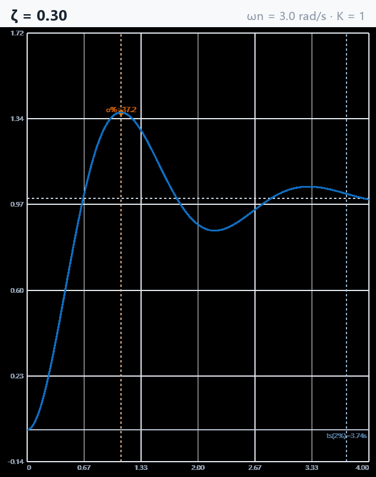

# control-lab · 自动控制原理交互实验台

[](https://leslieryin.github.io/control-lab/)


**打开即用的单文件 HTML**——[在线直接用](https://leslieryin.github.io/control-lab/)，或下载 `index.html` 双击离线运行。零依赖、零安装、离线可用、手机也能开，所有计算在本地完成。

为《自动控制原理》课程的核心概念而设计：与其背公式，不如拖动滑块亲眼看 ζ、K<sub>p</sub>、K<sub>i</sub>、K<sub>d</sub> 改变时曲线如何变化。

> **EN** — A single-file interactive lab for classical control theory: step response, PID, Bode, Nyquist, root locus, plus a drag-the-poles margin playground, a Nyquist D-contour animation, a gain-slider root locus, a PID rocket-landing game, a sampled digital PID bench and an LQR weight playground — all computed locally in your browser. [Try it →](https://leslieryin.github.io/control-lab/)



## 十一个实验

- **二阶系统阶跃响应** —— 标准二阶系统 G(s)=Kω<sub>n</sub>²/(s²+2ζω<sub>n</sub>s+ω<sub>n</sub>²) 的单位阶跃响应。拖动 ζ / ω<sub>n</sub> / K，实时显示超调量 σ%、峰值时间、上升时间、调节时间（2%/5%）。
- **PID 控制器** —— 对「一阶惯性+纯滞后」或「二阶振荡」对象做闭环 PID 控制（RK4 数值仿真，含微分滤波与抗积分饱和）。拖动 K<sub>p</sub>/K<sub>i</sub>/K<sub>d</sub>，同时看响应曲线与控制器输出 u(t)，附「仅 P」对照线与 IAE 指标。
- **Bode 图** —— 任意有理传递函数的幅频/相频特性。输入分子/分母多项式系数，自动标注幅值穿越 ω<sub>c</sub>、相角裕度 γ、幅值裕度 h，并求解闭环极点交叉验证稳定性。
- **Nyquist 图** —— 开环幅相曲线与稳定性判据。同一传递函数，绘制完整 Γ 曲线（含共轭镜像），标出临界点 (-1, j0) 与单位圆，报告右半平面闭环极点数 Z。
- **根轨迹** —— 闭环极点随增益 K (0→∞) 的运动轨迹。点击画布放置开环极点/零点（Shift+点击放共轭对），K 对数扫掠绘制轨迹（Durand-Kerner 求根），颜色对应 K 大小，报告保持稳定的最大 K。
- **Bode 裕度游乐场** —— 在 s 平面上**拖动零极点**、对数旋 K，Bode 图与 γ/h 实时重算；把极点拖向虚轴，亲眼看相位裕度被一口口吃掉，加零点看它回血（PD/超前补偿的频域版本）。
- **Nyquist 围线动画** —— D 形围线在 s 平面巡游，右屏同步描出映射曲线；自动报告绕 −1 的顺时针圈数 N、开环右半平面极点 P 与 Z = N+P，并与闭环求根交叉验证。默认载入教材例 6.1。
- **根轨迹 · 增益滑块** —— 完整轨迹点云之上拖 K，闭环极点沿轨迹实时跑，右图同步当前 K 的闭环阶跃响应与主导阻尼比；极点踩上虚轴即临界高亮（示例系统藏 K=16 彩蛋，对接教材第 7 章）。
- **PID 救火箭** —— 游戏化闭环：调 K<sub>p</sub>/K<sub>i</sub>/K<sub>d</sub> 让 100 m 高空的火箭软着陆（推力单向受限）。P 催落、D 刹车、I 帮倒忙，落地速度评分，滑块可在下落途中实时拧。
- **采样与数字 PID** —— 教材第 13 章 · 实验 10：对象 1/(s+1) 经 ZOH 离散化，采样序列与 z 平面闭环极点同屏；K<sub>c</sub>=(1+e<sup>−T</sup>)/(1−e<sup>−T</sup>)、「隔拍振铃」、数字 PI 稳定三角形 K<sub>i</sub>&lt;(2/T)(K<sub>c</sub>−K<sub>p</sub>) 全部可亲手拧出来。
- **LQR 权重游乐场** —— 教材第 14 章 · 实验 11：双积分器（实验 9 火箭的线性化）上拖动代价权重 q<sub>1</sub>/q<sub>2</sub>/r，闭式 Riccati 解实时给出最优状态反馈 K=[√(q<sub>1</sub>/r), √(q<sub>2</sub>/r+2√(q<sub>1</sub>/r))]；阶跃响应、控制量 u(t)、s 平面极点与 r 扫掠轨迹同屏，q<sub>2</sub>=0 亲眼看巴特沃斯角（ζ=0.707），PM 芯片全程 ≥ 60° 验证 Kalman 回差定理。

## 快速开始

```bash
# 方式一：直接双击 index.html
# 方式二：本地起个服务（支持手机访问）
python -m http.server 8123
# 浏览器打开 http://127.0.0.1:8123/
```

## 各实验的理论速查

**二阶系统（ζ 分档）**：ζ<1 欠阻尼（振荡+超调）；ζ=1 临界阻尼；ζ>1 过阻尼。σ% = e^(−πζ/√(1−ζ²)) ×100%，t<sub>p</sub> = π/ω<sub>d</sub>，工程常取 ζ≈0.707。

**PID**：K<sub>p</sub> 加快响应但过大致振荡；K<sub>i</sub> 消除稳态误差但降低稳定裕度；K<sub>d</sub> 抑制超调。本实验含两个工程细节：微分项一阶低通滤波（抑制噪声放大）与积分抗饱和（输出受限时冻结积分）。

**频域判据**：相角裕度 γ=180°+∠G(jω<sub>c</sub>)、幅值裕度 h=−20lg|G(jω<sub>π</sub>)|；两者同时为正是最小相位系统闭环稳定的充分条件。Nyquist 判据：Γ 曲线逆时针包围 (-1,j0) 的圈数 = P−Z。

**根轨迹法则**：n 条分支起于开环极点、m 条终于开环零点，其余 n−m 条沿渐近线 (2k+1)π/(n−m) 趋于无穷；实轴上的段右侧零极点总数为奇数。

**LQR（双积分器）**：J=∫(q<sub>1</sub>x<sub>1</sub>²+q<sub>2</sub>x<sub>2</sub>²+r·u²)dt 的最优反馈是 u=−Kx，K=[√(q<sub>1</sub>/r), √(q<sub>2</sub>/r+2√(q<sub>1</sub>/r))]（代数 Riccati 方程的闭式解）。q<sub>1</sub> 加大=更狠地罚偏差（ω<sub>n</sub> 升），r 加大=油钱更贵（整体放缓）；ζ=k<sub>2</sub>/(2√k<sub>1</sub>) 由权重比决定，与"最佳阻尼比 0.707"不是一回事。Kalman 回差定理：|1+L(jω)| ≥ 1 ⇒ 相位裕度 ≥ 60°、增益可减半而不失稳——LQR 出厂自带。

## 实现说明

- 单文件 `index.html`（原生 JS + Canvas，无任何外部依赖，约 32KB）
- 复数运算、多项式求值、Durand-Kerner 迭代求根均为内置实现
- 二阶系统阶跃响应用**解析法**（部分分式留数），频域图用对数扫频 + 相位解卷绕，PID 用 RK4 定步长积分（步长 4ms）
- 已对照教材公式人工核对过：ζ=0.3 时 σ%=37.2%、t<sub>p</sub>=1.10s 与理论值精确一致

## 测试

```bash
node tests/math.test.mjs   # 数学断言（求根、阶跃回归、PID 对象回归）
node tests/extras.test.mjs # 实验 6—11 断言（裕度穿越、Nyquist 圈数、ZOH 离散、火箭物理、LQR）
node tests/syntax.test.mjs # 整体内联 script 的语法兜底
```

需要 Node ≥ 18（测试用了 top-level await；CI 矩阵跑 20/22）。

拿有解析解的多项式对拍求根算法——它是根轨迹和 Bode 图的地基，算错了页面不报错、只会静默画出错误的曲线。CI 每次提交都跑一遍：

- 一次到四次的已知根：`s²+3s+2`、`s²+2s+5`（共轭复根）、`(s-1)²`（重根）、`s⁴+5s²+4`（两对纯虚根）
- 三阶重根 `(s-1)³` —— Durand-Kerner 这类迭代法最容易在这里收敛失败
- 所有根代回多项式，最大残差 **1.3e-15**
- 退化输入不崩：空系数、常数、末位为零（`s²+3s` 的根应含 0）

测试不复制源码：`tests/extract.mjs` 每次运行时从 `index.html` 里现切，测的一定是用户实际加载的那份，不会出现测试与线上代码各走各的。

CI 还会守住「单文件零依赖」这个承诺——`index.html` 里一旦出现外部 `<script src>`、CDN 字体、`fetch()` 之类的联网调用，构建直接失败。

## 适合谁

- 正在学《自动控制原理》的本科生（配合课程实验预习/复习）
- 需要向学生演示参数影响的老师（投影即用，无需装 MATLAB）
- 想快速 sanity-check 一个传递函数稳定性的工程师

## License

MIT
